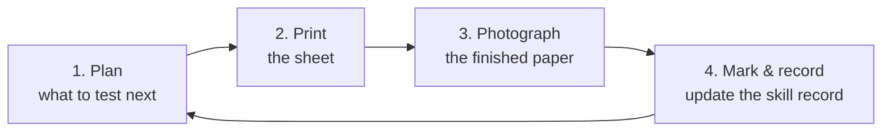
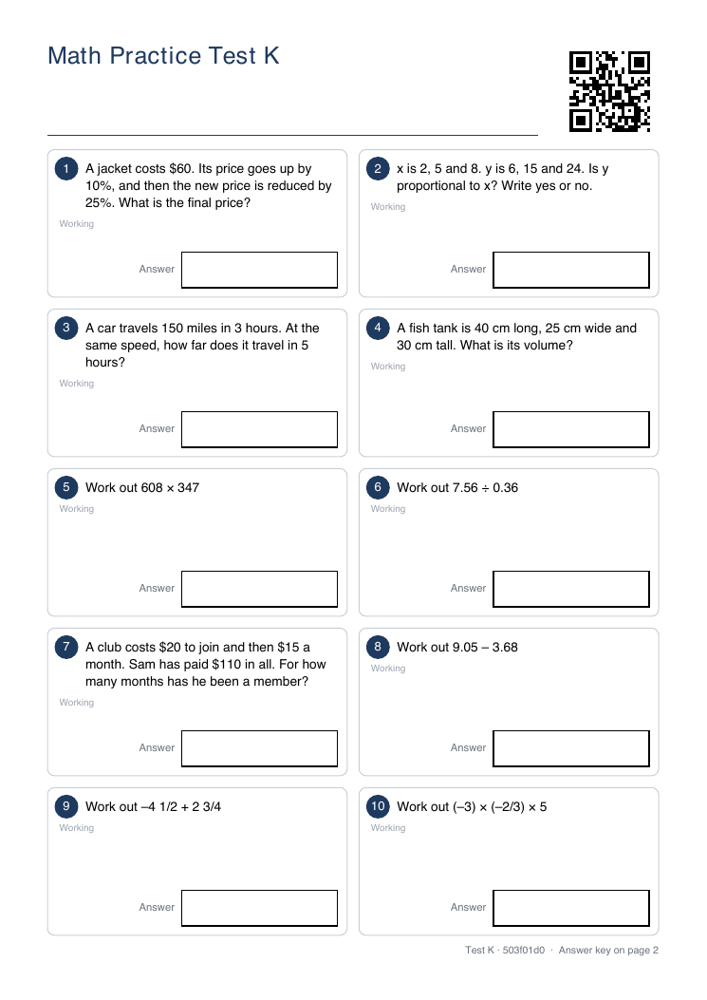
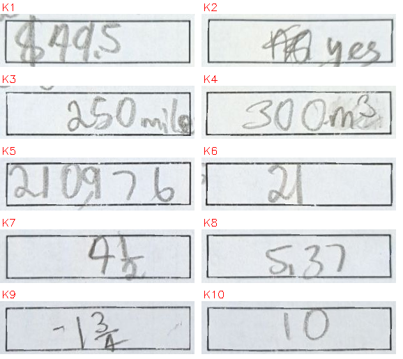
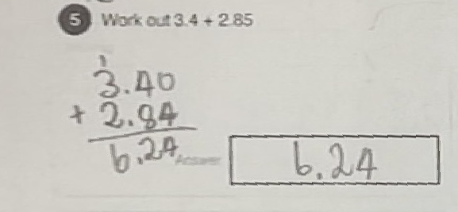
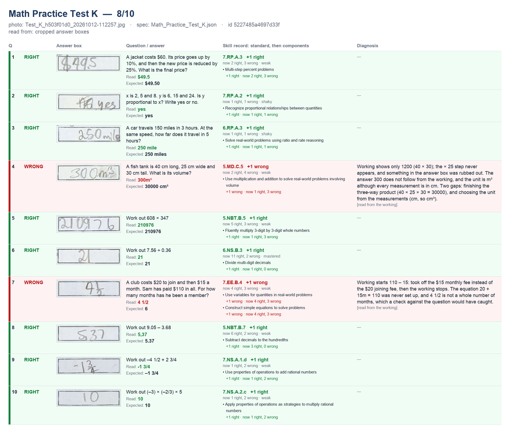
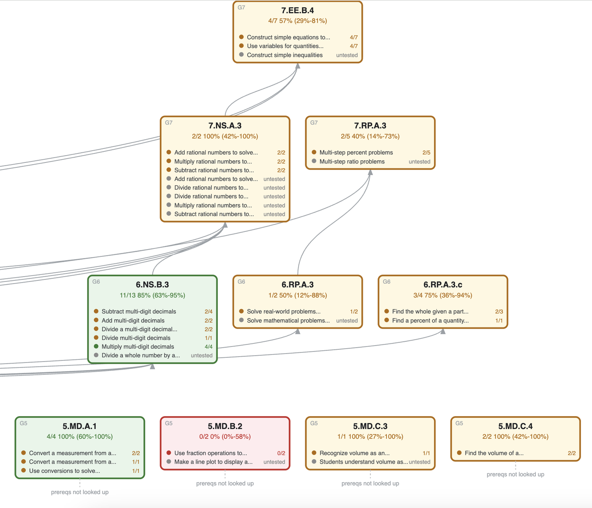
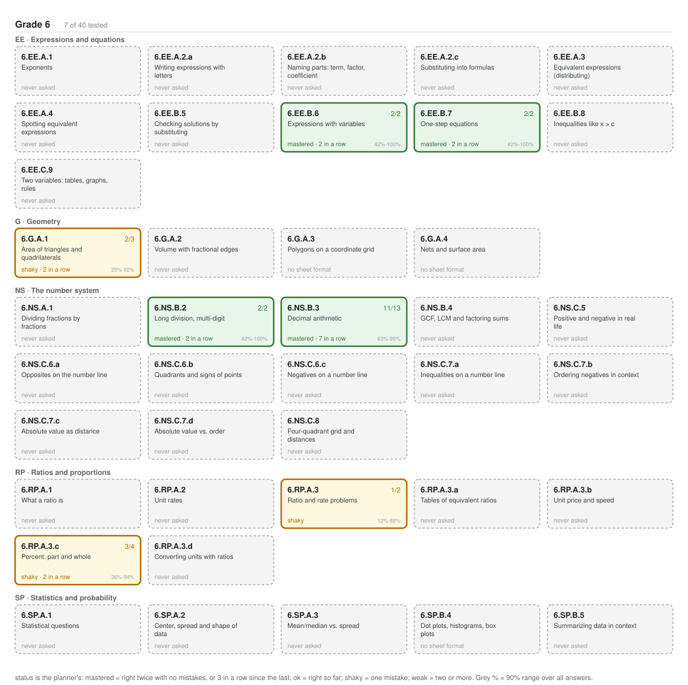

# Math assessments

Printable 10-question math tests for a child, marked from a phone photo, feeding
a skill record that decides what the next test should cover.

For a parent, not the child: the child works on paper and never interacts with
any of this.

## The loop at a glance



| Step | Who does it | In Claude Code, say… | Or run by hand |
|---|---|---|---|
| **1. Plan** the next sheet | `skills.py` picks the standards; Claude writes the questions | "make the next test" | `python3 skills.py --plan`, then add the questions to `make_tests.py` |
| **2. Print** it | `make_tests.py` writes the PDF; the child works on page 1 | (part of step 1) | `python3 make_tests.py` |
| **3. Photograph** the finished paper | You, then drop the photo in `inbox/` | — | — |
| **4. Mark & record** | OpenCV crops the answers, Claude reads them, `record_paper.py` marks against the spec | "mark the paper in the inbox" | see [step 4](#4-mark-and-record) |

The scripts call no model and need no API key. Alignment and cropping are
OpenCV, marking is arithmetic against the spec, and the reading is done by
Claude in chat. The two chat phrases trigger the skills in `.claude/skills/`:
`new-assessment` for steps 1–2 and `mark-paper` for step 4.

**Jump to:** [Getting started](#getting-started) ·
[How the next test is chosen](#choosing-the-next-test) ·
[How sure the record is](#how-sure-the-record-is) ·
[The skill graph](#seeing-the-graph) ·
[Photo tips](#dropping-in-a-photo) ·
[Files](#files)

## The loop, step by step

The images are from real papers, mostly Test K.

### 1. Plan

```
python3 skills.py --plan              # what the next sheet should ask, and why
python3 skills.py --plan --sheets 3   # a batch of up to 3 sheets
```

The plan mixes four kinds of question: skills answered **wrong** before, roster
standards **never asked**, harder standards whose foundations are now
**mastered**, and spaced **review** of skills answered right. It also lists what
it is holding back and why. The questions are then written into `make_tests.py`
under a new letter. → [How the next test is chosen](#choosing-the-next-test)

### 2. Print

```
python3 make_tests.py                 # new sheets into tests/: PDF + JSON spec each
```

Page 1 is for the child; page 2 is the answer key. The QR code identifies the
sheet and the exact layout of its answer boxes. Every answer is computed in
code, and a sheet that may already be printed is never changed.



### 3. Photograph

Take a phone photo of the finished paper, with all four corners in frame, and
drop it in `inbox/`. → [Photo tips](#dropping-in-a-photo)

### 4. Mark and record

```
python3 prepare_inbox.py                                      # straighten, read the QR, crop every box
# Claude reads the crops in chat
python3 record_paper.py <sha1> --readings '{"K1": "49.5", ...}'
python3 record_paper.py <sha1> --diagnose '{"K7": "..."}'      # if a wrong answer is unexplained
python3 review.py                                             # confirm readings flagged as unsure
python3 skills.py                                             # updated record, graph and next plan
```

**The answer boxes.** The page is straightened on the ten printed answer boxes
and each box is cropped. These crops are what Claude reads, so a stray mark
elsewhere on the page cannot be mistaken for an answer.



**The working, for wrong answers.** A working region is cropped alongside each
box, because the answer alone often points at the wrong skill. Claude compares
the working with the question text from the spec. In this example from Test C
(the whole question cell), the question asks for 3.4 + 2.85 and the answer is
6.24 against 6.25. The answer alone suggests an addition error. The working
shows 2.85 copied as 2.84 and then added correctly, so the diagnosis is a
transcription slip, not a carrying or place-value gap.



**The review card.** One row per question: the answer box, what was read
against what was expected, how the standard and each component moved, and the
diagnosis with where it came from. A reading that is wrong in either direction
is worse than none, since a corrupted correct answer makes the next test chase
a weakness the child does not have. Readings marked unsure are held out of the
record until `review.py` confirms them.



The record then feeds the next plan, and the loop starts again.
→ [The skill graph](#seeing-the-graph) · [How sure the record is](#how-sure-the-record-is)

## Getting started

### Scope

Grades 5–7, Common Core (California) standards. The curriculum data shipped in
`cache/` covers:

- **Grades 5 and 6** — the complete rosters, 26 and 40 standards.
- **Grade 7** — only the 8 standards reachable from grade 5 through the
  Coherence Map, not the full roster.
- **Components** — every standard in all three rosters.
- **Prerequisites** — cached for the standards tested so far, reaching back to
  grade 4. `skills.py --expand` fetches deeper ones, never below grade 3.

The question templates in `make_tests.py` cover grades 5–7. Another grade
needs its roster in `cache/syllabus.json`, its components and prerequisites
fetched into the cache, and question templates.

### Requirements

- **Claude Code.** Claude reads the answers off the photos, and the two skills
  in `.claude/skills/` run the loop from chat.
- **Learning Commons access:** the Learning Commons connector in Claude, or a
  free API key from https://platform.learningcommons.org in
  `LEARNING_COMMONS_API_KEY`. The shipped cache covers grades 5–7 as described
  above. Anything beyond it needs one of the two: a prerequisite that is not
  cached, `skills.py --expand`, `verify_graph.py --refetch`, or a new grade.
  The scripts themselves use only the API key; with the connector instead,
  Claude fetches in chat and writes the result into `cache/`. Without either,
  a lookup that misses the cache stops with an error rather than guessing.

### Setup

Python 3, in a virtualenv inside this folder:

    python3 -m venv .venv
    .venv/bin/pip install -r requirements.txt

The commands in this README write `python3` for short; use `.venv/bin/python`, or
activate the venv first. Run everything from this folder: `make_tests.py`
writes to `tests/` relative to the working directory.

## How it decides

### Choosing the next test

    python3 skills.py --plan              # what the next sheet should ask, and why
    python3 skills.py --plan --sheets 3   # a batch of up to 3 sheets, no standard repeated
    python3 skills.py --coverage 5        # how much of a grade has been touched

Four reasons are weighed on every sheet, with a quota so none crowds the others
out (4 / 3 / 1 / 2 of ten questions; unused slots go to the others):

- **Failure** — something is known to be wrong. Retest it, and if it has failed
  twice, test what it rests on.
- **Coverage** — a standard in the grade roster nobody has been asked about.
  Grade 5 first, so gaps are found before they are inherited.
- **Readiness** — a grade 6 or 7 standard whose grade-5 foundations are
  mastered. One whose foundations are still shaky is held back, and the plan
  prints what it is waiting on, because "why is this *not* on the test" is as
  useful as what is.
- **Review** — spaced repetition. A skill whose last answer was right comes
  back 2 days after one right answer in a row, then 7, 21 and 60 days. Most
  overdue first, asked with new numbers rather than as a copy.

Without the quota the sheet fills entirely with failures: known gaps get
re-tested and nothing new is ever discovered.

The plan names standards; the questions themselves are written into
`make_tests.py` under a new letter, using its question templates, so every
answer is still computed and checked in code.

`cache/syllabus.json` holds the rosters (see [Scope](#scope)). It also marks the
standards that **cannot** be asked on a ten-box sheet — line plots,
classifying figures, graphing on a grid — so coverage stops offering them. They
still need teaching; they need a different sheet.
### How sure the record is

A mastery figure from a handful of questions would lie — 1 out of 1 is not
"100% mastered". Every skill carries a Wilson 90% interval, and its status is
read off the cautious end: a skill is **strong** only when even the low end of
the interval clears 58%, and **weak** when even the high end falls below it.

One right answer gives a wide interval that cannot reach strong. The interval
narrows as questions accumulate, so a skill earns "strong" by being tested
repeatedly rather than by one lucky answer — four correct in a row, or more if
there have been slips. That is the whole mechanism by which confidence improves
with testing, and the graph prints how many more correct answers each skill
still needs.

Thresholds are set for how much evidence actually accumulates here: a skill gets
one or two questions per 10-question test. The cut is 58% rather than 60%
because 4/4 puts the low end at 59.65%, and missing "strong" by 0.0004 is an
artifact of where the bar sits. "Weak" lands at two wrong with nothing right,
which is also when `skills.py` starts walking back to prerequisites.

### Two levels: standards and components

A standard bundles several skills. `6.NS.B.3` covers adding, subtracting,
multiplying and dividing decimals, so "4/5 on 6.NS.B.3" can mean subtraction is
broken and the other three are fine. The graph prints an "inside this standard"
block naming the weak part, and `skills.py` attaches it to the next test as a
focus.

The two levels answer different questions, and Learning Commons supplies them
from different datasets:

- **Components** (ANet, `cache/components.json`) — *which part* of a standard is
  weak. Stable UUIDs, so the same id means the same skill across tests.
- **Standards + Coherence Map** (`cache/prereqs.json`) — *what to fall back to*
  when a skill stays weak. Prerequisites exist only between standards, never
  between components.

### Standards and prerequisites

Questions carry a CCSS code and Learning Commons learning-component IDs. When a
skill fails repeatedly, `skills.py` walks back through the SAP Coherence Map to
the standards it depends on and puts the untested ones on the next test, staying
within about two grade levels.

`prereq.py` works from `cache/prereqs.json` without a key. With a free key in
`LEARNING_COMMONS_API_KEY` it fetches and caches anything missing. A standard
that is neither cached nor fetchable raises rather than guessing: a wrong
progression sends the next test after the wrong skill. `verify_graph.py` checks
the cached edges against the source. Learning Commons data is CC BY 4.0 — show
the `attributionStatement` wherever it is displayed.

### Going deeper when the basics are the problem

    python3 skills.py --expand        # needs LEARNING_COMMONS_API_KEY

The bottom row of the graph is where the cached map ran out, not where the
curriculum ends. When a node down there is weak, `--expand` pulls its
prerequisites in so the chain keeps going — because a failing grade-5 skill
usually means the grade-4 one under it deserves a look before drilling grade 5
again. Only weak and shaky standards are expanded, so the graph grows where the
evidence is.

The grade floor adapts: normally two grades below working level, but it drops to
one grade below the lowest standard that is actually weak, never past grade 3.

### Seeing the graph

`python3 skills.py` prints it and saves three forms in `cache/`:

| | |
|---|---|
| `graph.svg` | The dependency view: arrows from each prerequisite up to what it supports. Wide, because a row holds every standard at the same depth. |
| `graph_by_grade.svg` | The same record laid out by grade and domain, **no edges**. Fits a screen, and shows coverage — every roster standard appears, dashed if never asked. |
| `graph.txt` | The text version, same as printed. |

In the SVG every arrow runs from a prerequisite **up** to what it supports. Rows
are dependency depth, not grade: a standard sits one row above the deepest
prerequisite drawn beneath it, and its grade is the small `G6` label in the
corner. Rows were originally grade-based, which looked natural but laid half the
edges flat along a row where they overlapped each other and hid their arrowheads
behind the boxes — `7.NS.A.3` alone has three grade-7 prerequisites.

A solid border means the skill has been tested; dashed means it is only in view
as a prerequisite. Colour is the status.

Part of the dependency view. Each card lists the components inside the
standard, so 6.NS.B.3 reads as mastered overall while subtracting decimals is
still 2/4. The bottom row is where the cached prerequisites run out:



The by-grade view, grade 6 only. Seven of the 40 standards have been asked;
the dashed cards are the coverage gaps the planner works through, and
"no sheet format" marks the ones a ten-box sheet cannot ask:



In VS Code, an SVG opens in the editor directly; `.dot` needs an extension such
as *Graphviz Interactive Preview*.

## Photos

### Dropping in a photo

A photo of a finished paper: .jpg, .jpeg, .png or .webp, in `inbox/`. Each image
is keyed by its SHA-1, so a photo that has already been recorded is skipped;
`prepare_inbox.py --force` redoes one.

EXIF covers the orientation of most phone photos. Webcam shots are mirrored and
have to be told so, for the whole batch with `--transform mirror,ccw`, or per
file in `inbox/orientation.json`, matched against any part of the filename:

    {"3.51": "mirror,ccw", "12.36": "mirror,cw"}

Steps are comma-separated, from `mirror`, `cw`, `ccw`, `180`.

Get all four corners of the sheet in the photo, lay the page flat and keep
fingers off the corners. If fewer than six answer boxes are found it stops and
asks for a retake rather than guessing.

School worksheets have no QR or boxes to register on, so the page is written
out as two large overlapping halves for Claude to read directly. That works,
but it is slower, so prefer generated papers. Files prefixed `corrected_` are
treated as a second pass over a paper already recorded and are skipped unless
`--include-corrected` is given.

### Alignment

The page is registered on the ten printed answer boxes, not the corner markers.
Parents do not frame photos carefully, and on the first real photo two of the
four corner markers were outside the frame — the boxes are large, spread across
the page and survive a cut-off edge. Row positions are anchored on the QR code
rather than on the topmost box found, so a missed box does not shift every
answer in that column onto the wrong question.

## Files

| | |
|---|---|
| `make_tests.py` | Writes each new sheet once into `tests/`, with a QR payload fingerprinted on what page 1 prints; refuses to change a sheet that may be printed. Every answer and predictable wrong answer is computed in code, so a question the code cannot verify is rejected. Writes the PDF and the JSON spec. |
| `prepare_inbox.py` | Photo → upright page → QR → cropped answer and working regions. Pure OpenCV. |
| `align_and_crop.py` | Registers the page on the ten printed answer boxes and crops them. Used by `prepare_inbox.py`. |
| `qr_read.py` | Decodes the sheet's QR, upscaling when the code is too small in the photo. Shared by the two scripts above so they agree on whether a sheet has a readable code. |
| `record_paper.py` | Takes what Claude read, marks it against the spec, writes one record per paper and renders its review card. |
| `mark.py` | The comparison rules: numeric, ¢ ↔ $, units when the question demands them. |
| `review.py` | Confirms readings flagged as unsure before they count. |
| `review_card.py` | Renders a marked paper as one image: each question, what was read against what was expected, the skill, and the diagnosis. |
| `skills.py` | Aggregates every paper into a per-skill record and plans what the next test should cover. |
| `prereq.py` | Learning Commons: standards and their prerequisites, with a file cache. |
| `graph.py` | The knowledge graph printed after every analysis: which pathways are tested, strong, weak or never reached. `--dot` emits Graphviz, `--svg` an SVG. |
| `verify_graph.py` | Checks the cached prerequisite edges against Learning Commons. `--refetch` (needs a key) exits non-zero on any difference. |

| | |
|---|---|
| `tests/` | One PDF and JSON spec per sheet (`tests/legacy/v<N>/` holds the earlier per-run folders, still matched by their QR codes). The spec is what marking reads, so it has to outlive the printout. |
| `cache/syllabus.json` | The grade rosters, and which standards cannot be asked on a ten-box sheet. |
| `cache/components.json` | Learning Commons components for each standard. |
| `cache/prereqs.json` | Learning Commons prerequisites, seeded so the pipeline runs without an API key. |
| `docs/` | The example images in this README. |

Created when the loop runs, and kept out of git because they hold the child's
work:

| | |
|---|---|
| `inbox/` | Drop photos here (see [Photos](#photos)). |
| `cache/papers/` | One record per paper, keyed by image SHA-1. |
| `cache/prepared/` | The upright page and crops for each paper. |
| `cache/reviews/` | The review card for each paper. |
| `cache/graph.txt`, `graph.svg`, `graph_by_grade.svg` | The latest knowledge graph, rewritten by every `skills.py` run. |
